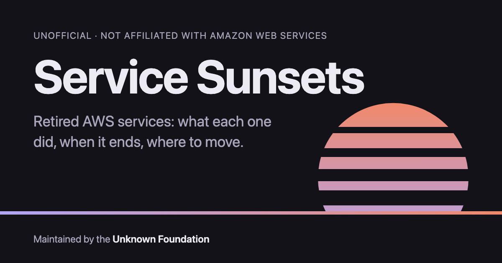

# Service Sunsets

<!-- register:summary -->
**Updated 17 Nov 2026** · 123 entries · Search and filter it on the web: [https://unknownfoundation.github.io/service-sunsets/](https://unknownfoundation.github.io/service-sunsets/)
<!-- /register:summary -->

Covers 2025 to 2027, plus changes from 2024 that still apply. AWS retires services in batches; this list keeps them in one place, each with the AWS page that says so.

The full list, with every table, is in [docs/list.md](docs/list.md).

## Who it is for

- You run workloads on AWS and want to know whether a service you use has an end date.
- You are planning a move off a service AWS is retiring.
- You are choosing a service for a new system and want to skip one AWS has closed to new customers.

Found it useful? Star the repository: it helps other teams find the list.

## Check your own accounts

**AWS Health** lists the scheduled changes that apply to your account and Regions. Where its dates differ from this list, trust AWS Health.

## Not on this list

The version deadlines in [docs/list.md](docs/list.md) cover only the most common versions. AWS keeps the full lists for [Lambda runtimes](https://docs.aws.amazon.com/lambda/latest/dg/lambda-runtimes.html), [EKS versions](https://docs.aws.amazon.com/eks/latest/userguide/kubernetes-versions.html), [AWS SDKs](https://docs.aws.amazon.com/sdkref/latest/guide/version-support-matrix.html) and [Amazon Linux 2](https://aws.amazon.com/amazon-linux-2/faqs/).

This list follows AWS's lifecycle pages and adds only what another AWS page confirms. A feature AWS retired without a line on those pages may be missing.

## About this list

- Maintained by the [Unknown Foundation](https://github.com/unknownfoundation).
- Dates come from AWS's lifecycle pages ([Full shutdown](https://docs.aws.amazon.com/general/latest/gr/full_shutdown_services.html), [Sunset](https://docs.aws.amazon.com/general/latest/gr/sunset_services.html), [Maintenance](https://docs.aws.amazon.com/general/latest/gr/maintenance_services.html)) and each service's own page. Found a wrong date? Open an issue in this repository with the AWS link that shows the right one.
- Unofficial. Not affiliated with or endorsed by Amazon Web Services. AWS and the service names are trademarks of Amazon.com, Inc. or its affiliates. Other names are trademarks of their owners. Naming a product is not an endorsement.
- Provided as is, without warranty. Not legal or professional advice.
- The web page sets no cookies and runs no analytics. Your theme choice stays in your browser. GitHub Pages, which hosts the page, keeps server logs, including IP addresses, under the [GitHub Privacy Statement](https://docs.github.com/en/site-policy/privacy-policies/github-general-privacy-statement).
- Our own text and code are under the [MIT license](LICENSE). AWS's names and the facts reported are not ours to license.
- The list lives in `data/register.toml`, and `python3 -I build.py write` checks it and rewrites this file, `docs/list.md` and the page.
